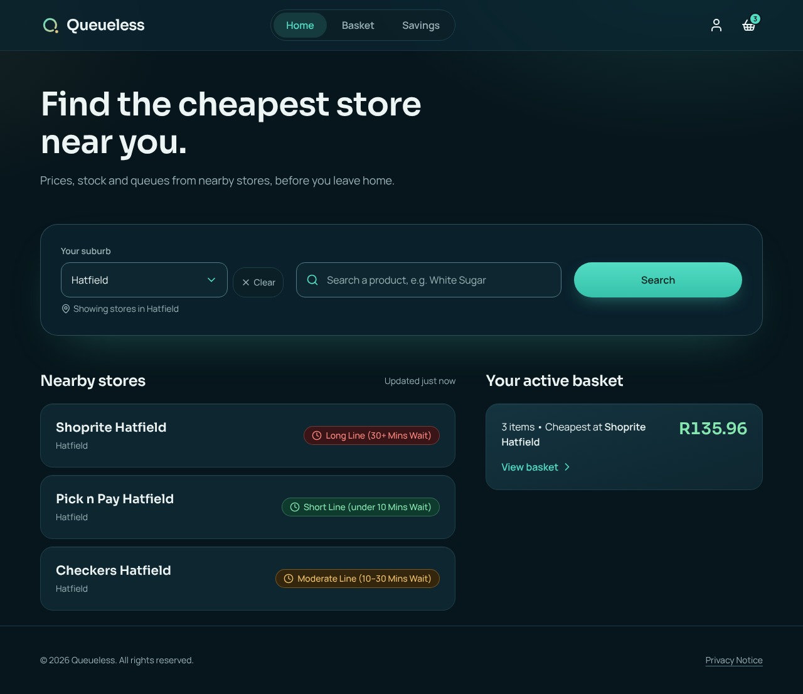
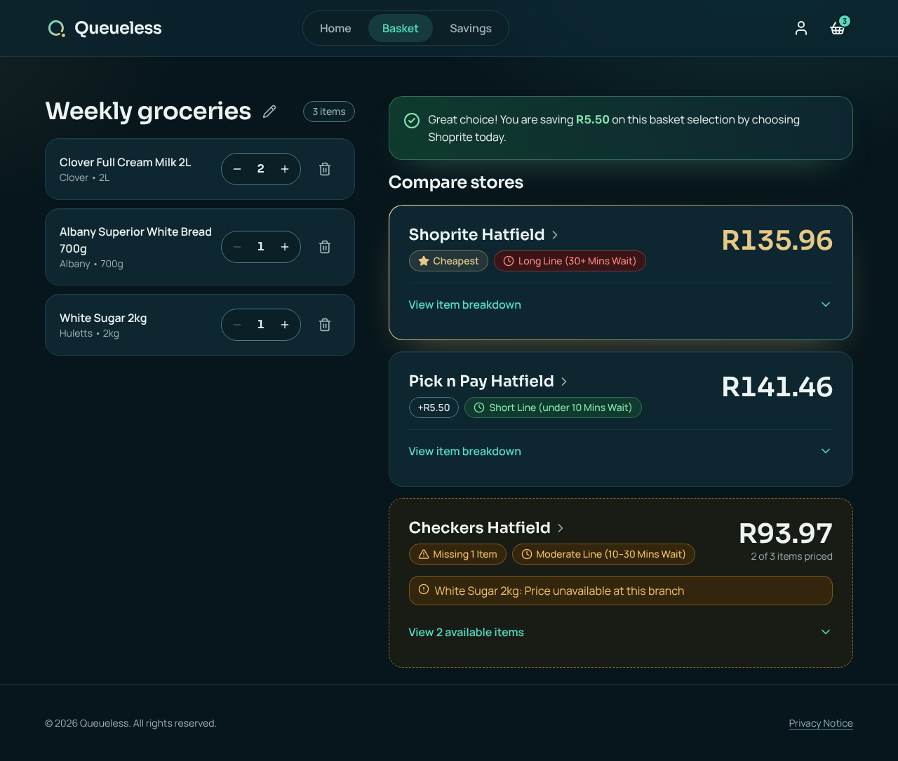
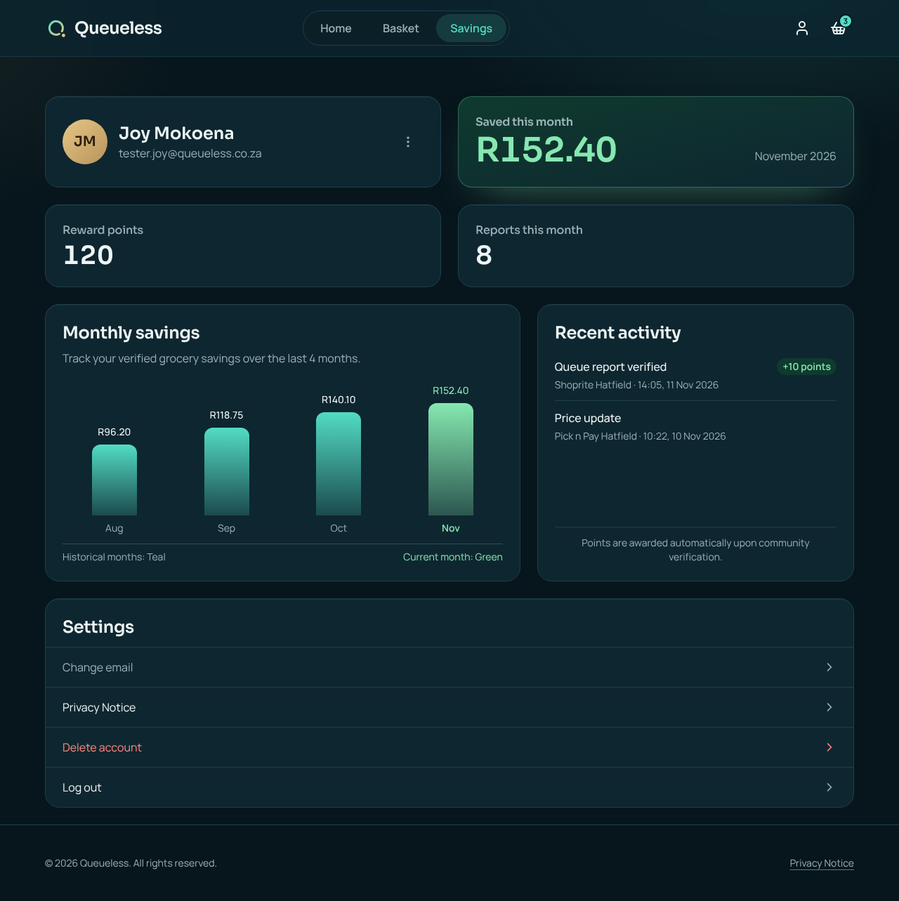
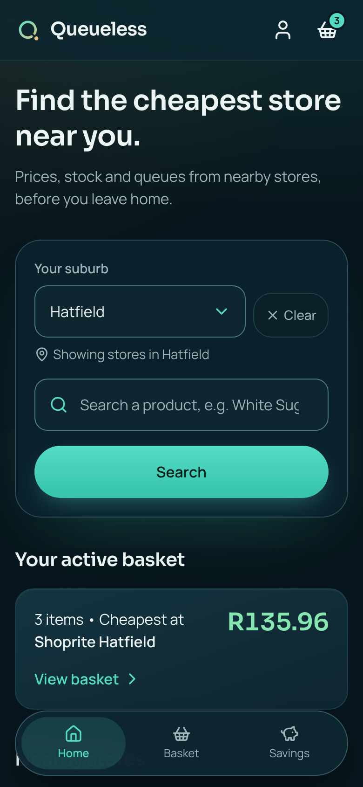
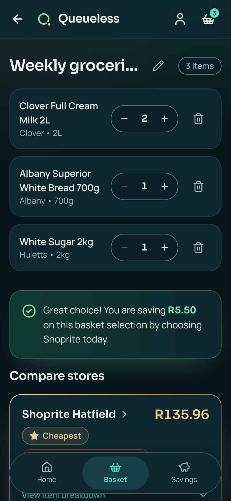
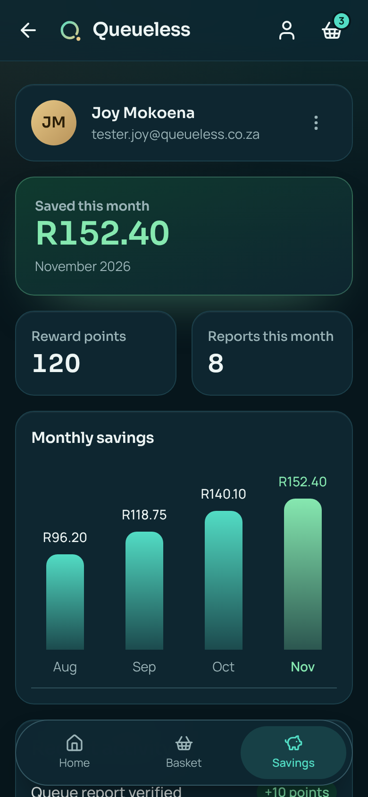

# Queueless

> A platform that helps users shop smarter by comparing prices across nearby stores, checking product availability, and avoiding unnecessary queues and shopping trips.

**Team:** CoPilot

**The problem it solves:** Shoppers often don't know which nearby store has the best price, or whether a product is even in stock, until they get there. That leads to wasted trips, long queues and overspending. Queueless brings prices, stock availability and queue information from nearby stores into one place, so users can decide where to shop before they leave home.

## 🔗 Links

| Resource       | Link                                                     |
| -------------- | -------------------------------------------------------- |
| Live app       | https://queueless-copilot.vercel.app/                    |
| Stitch project | [Queueless on Stitch](https://stitch.withgoogle.com/projects/14854798444949179025) |
| Project board  | [Queueless Board](https://github.com/users/mpho09/projects/1) |
| Team Loom      | 🚧 Being recorded on the live link (link added here before the Final) |
| PRD            | [docs/PRD.md](docs/PRD.md)                               |
| Designs        | [docs/designs/](docs/designs/) (exported screens: `screen.png` + `code.html`) |
| Implementation | [docs/IMPLEMENTATION_PLAN.md](docs/IMPLEMENTATION_PLAN.md) |

## 📋 Project Documentation

We use the Product Requirements Document (PRD) as our single source of truth for features, business logic and database schemas. Make sure the PRD is updated and approved before editing any core code.

- **[Product Requirements Document (PRD)](docs/PRD.md)**: core specification, user stories, screen flows, data model and compliance rules.
- **[Implementation Plan](docs/IMPLEMENTATION_PLAN.md)**: step-by-step build sequence, tech stack configuration and automated testing definitions.

## 👥 Team & Roles

| Name    | GitHub                                                       | Role(s)                        | Main features built |
| ------- | ------------------------------------------------------------ | ------------------------------ | ------ |
| Mpho    | [@mpho09](https://github.com/mpho09)                         | Tech Lead, Backend Dev         | Database schema, RLS, seed and RLS tests (#25); Search Results S2 + `search_products()` (#34); live-site sample-data guard (#42); Store Details S3 + BR4 queue view (#45); profile created on sign-up (#44) |
| Joy     | [@jjmolomo17-tech](https://github.com/jjmolomo17-tech)       | Product Owner, Frontend Dev    | Suburb selector on Home (#27) |
| Refilwe | [@Ref-DevSa](https://github.com/Ref-DevSa)                   | Frontend Dev, Designer         | Frontend foundation + Home S1 (#22); Basket S4 + BR3 totals (#23); Savings S6, savings API, price-drop rule + email helper (#28–#33); S6 log-in guard (#48); Delete account + daily purge (#47) |
| Elias   | [@eliasmtisie4321](https://github.com/eliasmtisie4321)       | QA, DevOps                     | Report Submission S5 + Stores list + report rules (#35); Vercel deployment (#37) |
| Kabelo  | [@kabelomathapo6-lab](https://github.com/kabelomathapo6-lab) | Designer, Frontend Dev         | "Midnight Lagoon" dark design (#36); auth helpers `requireUser`, `useAuth`, `authStore` (#41) |

## ✨ Features

Status key: ✅ done · 🚧 in progress · ⏸️ cut / deferred

### Must have

| Feature | Status | Owner |
| ------- | ------ | ----- |
| Accounts: log in, sign up, reset, verify (A1–A4, #14) | 🚧 Auth core merged (`authStore`, `useAuth`, `requireUser`, #41); profile created on sign-up (#44); the A1–A4 screens are still placeholders | Kabelo, Mpho |
| F1 Product search & price compare (S2, #11) | ✅ | Mpho |
| F1 Store Details with queue status (S3, #12) | ✅ Store Details + BR4 queue view (#45) | Mpho |
| F2 Cross-store basket (S4, #16) | ✅ Guest basket in localStorage | Refilwe |
| F3 Queue/stock report submission (S5, #18) | ✅ Needs log-in to submit | Elias |
| Database: schema, RLS, seed (#8) | ✅ | Mpho |

### Should have

| Feature | Status | Owner |
| ------- | ------ | ----- |
| F4 Suburb filter (#19) | ✅ Selector on Home and Search | Joy |
| F5 Savings dashboard + savings API (S6, #20) | ✅ Screen and `/api/me/savings`, logged-in only (#48); Delete account with a daily purge job (#47) | Refilwe |
| Price-drop email (#20) | 🚧 Rule and email helper built and tested; not scheduled yet | Refilwe |
| Per-account lockout (D11) | ⏸️ Cut; Supabase Auth's built-in rate limiting is used | — |
| Admin / Retailer dashboards (Feature 7) | ⏸️ Deferred (D10) | — |

## 🧱 Tech Stack & Architecture

| Layer    | Technology                                   |
| -------- | -------------------------------------------- |
| Frontend | React 19, Vite 8 (Three.js planned for 3D)   |
| API      | Node.js, Express 5                           |
| Database | Supabase (PostgreSQL, Auth, Row Level Security) |
| Tooling  | npm workspaces, Supabase CLI, GitHub Actions |

```
┌──────────────────────┐    /api/*     ┌──────────────────────┐   service role   ┌──────────────────┐
│  client/ (React +    │ ────────────▶ │  server/ (Express)   │ ───────────────▶ │                  │
│  Vite, port 5173)    │               │  port 3001           │                  │     Supabase     │
│                      │ ──────────────────── anon key + RLS ─────────────────▶ │  (Postgres/Auth) │
└──────────────────────┘                                                         └──────────────────┘
```

- **Frontend (`client/`)** — the React single-page app. In development, Vite forwards `/api/*` requests to the server. The browser uses the Supabase **anon key** for auth and for reads that Row Level Security allows ([client/src/lib/supabase.js](client/src/lib/supabase.js)).
- **API (`server/`)** — the Express REST API for business logic and privileged operations. It talks to Supabase with the **service role key**, which never leaves the server ([server/src/lib/supabase.js](server/src/lib/supabase.js)). In production it also serves the built client from `client/dist`.
- **Database (`supabase/`)** — SQL migrations live in [supabase/migrations/](supabase/migrations/) and test data in [supabase/seed.sql](supabase/seed.sql).

```
Queueless/
├── client/          React + Vite app
├── server/          Express API
├── supabase/        Supabase config, migrations and seed
└── .github/         CI workflows
```

## 💻 Run It Locally

### Prerequisites

- [Node.js](https://nodejs.org/) 20.19+ (built and tested on 22)
- Access to the team's hosted Supabase project (ask the Tech Lead). We don't run Supabase locally. [Docker](https://www.docker.com/) is only needed for `npm run db:test`
- Git

### 1. Install

```bash
git clone <repo-url>
cd Queueless
npm install          # installs client, server and the Supabase CLI
```

### 2. Environment variables

```bash
cp server/.env.example server/.env
cp client/.env.example client/.env
```

| File          | Variable                    | Description                                          |
| ------------- | --------------------------- | ---------------------------------------------------- |
| `server/.env` | `PORT`                      | API port (default `3001`)                            |
| `server/.env` | `SUPABASE_URL`              | Supabase project URL                                 |
| `server/.env` | `SUPABASE_SERVICE_ROLE_KEY` | Service role key. **Server only, never commit it.**  |
| `client/.env` | `VITE_SUPABASE_URL`         | Supabase project URL                                 |
| `client/.env` | `VITE_SUPABASE_ANON_KEY`    | Public anon key                                      |

Find the values under **Supabase Dashboard → Project Settings → API**, or ask the Tech Lead for them privately. Never post keys in the team thread or commit them.

### 3. Database: migrations & seed

We use **one shared hosted Supabase project** (no local database). Every database change is a migration file merged through a PR; never edit tables by hand in the dashboard.

```bash
npm run db:link -- --project-ref <project-ref>   # once per computer (Tech Lead shares the ref)
npm run db:migration -- <name>                   # create a new migration file
npm run db:check                                 # dry run: shows which migrations would be applied
```

After a migration PR is **merged into main**, the Tech Lead applies it:

```bash
npm run db:push      # apply new migrations to the hosted project
npm run db:seed      # apply migrations and load supabase/seed.sql
npm run db:test      # run the database tests in supabase/tests/ against the hosted project (needs Docker)
```

| Command | Description |
| --- | --- |
| `npm run db:link -- --project-ref <ref>` | Link this folder to the hosted project |
| `npm run db:migration -- <name>` | Create a new migration file |
| `npm run db:check` | Dry run: list migrations that would be applied |
| `npm run db:push` | Apply new migrations to the hosted project |
| `npm run db:seed` | Apply migrations and load the seed data |
| `npm run db:test` | Run the database tests against the hosted project (needs Docker running) |
| `npm run db:reset:hosted` | ⚠️ **Wipes the shared database** and rebuilds it from migrations + seed. Tech Lead only, and tell the team first |

The shared database is used by everyone and by the live site, so only push migrations that have been reviewed and merged.

### 4. Start

```bash
npm run dev          # starts the client (http://localhost:5173) and the API (http://localhost:3001)
```

| Command              | Description                                      |
| -------------------- | ------------------------------------------------ |
| `npm run dev`        | Start the client and server in watch mode        |
| `npm run dev:client` | Start only the Vite dev server                   |
| `npm run dev:server` | Start only the API server                        |
| `npm run build`      | Build the client into `client/dist`              |
| `npm start`          | Start the server (serves `client/dist` when `NODE_ENV=production`) |

## 🔑 Test Logins

> ⚠️ These are **test accounts only**, created by `supabase/seed.sql`. Never put real credentials here.

Test accounts are created on the hosted Supabase project once sign-up is live (#13, #14). **Passwords are never committed to this public repo.** Ask the Tech Lead for them privately, or create your own account on the live site.

| Role    | Email                         | Password            |
| ------- | ----------------------------- | ------------------- |
| Shopper | `tester.joy@queueless.co.za`  | shared privately    |
| Shopper | `mpho.dev@queueless.co.za`    | shared privately    |

## 🧪 Tests

Jest 29 for the client, Node's built-in test runner (`node:test`) for the server, and pgTAP SQL tests for the database.

```bash
npm test          # all client and server tests (220+ tests)
npm run db:test   # 108 pgTAP database tests in supabase/tests/
```

| Area | What's covered |
| ---- | -------------- |
| Client screens | Home, Search Results, Store Details, Basket, Savings (incl. log-in guard and session expiry), Report Submission, Stores list, Suburb selector |
| Client logic | BR3 basket totals, basket store, price age, distance, validation, formatting, `data.js` live/dev sample-data rules, search API, auth store and `useAuth` |
| Server | `GET /api/me/savings`, `POST /api/account/delete`, `requireUser` middleware and 401s from the real app, price-drop rule, Resend email helper |
| Database (`supabase/tests/`) | RLS rules, report rules (throttling, verification), savings events, `search_products()`, BR4 queue view, profile created on sign-up, account deletion and the daily purge job |

CI ([.github/workflows/ci.yml](.github/workflows/ci.yml)) runs on every pull request and push to `main`. It checks for leftover merge conflict markers and invalid JSON files.

## 🚀 Deployment

| Part     | Hosted on | Redeploys when |
| -------- | --------- | -------------- |
| Frontend | Vercel (static build of `client/dist`) | Every merge to `main` |
| API      | Vercel serverless function ([api/index.js](api/index.js) → `server/src/app.js`) | Every merge to `main` |
| Database | Supabase (hosted) | Tech Lead runs `npm run db:push` after a migration PR is merged |

Vercel settings live in [vercel.json](vercel.json). The project needs these **Environment Variables** in Vercel (Production and Preview):

| Variable | Used by |
| --- | --- |
| `VITE_SUPABASE_URL`, `VITE_SUPABASE_ANON_KEY` | Client. Baked in at **build** time, so redeploy after changing them |
| `SUPABASE_URL`, `SUPABASE_SERVICE_ROLE_KEY` | API (server only) |

Check the deployment: `https://queueless-copilot.vercel.app/api/health` should return `"database":"configured"`, and Home should make requests to `*.supabase.co` in the browser's Network tab.

## 📸 Screenshots

Design: "Midnight Lagoon" (see [docs/DESIGN_REFRESH.md](docs/DESIGN_REFRESH.md)).

| Home | Basket | Savings |
| --- | --- | --- |
|  |  |  |
|  |  |  |

## 🐞 Known Issues & What's Next

### Known issues

- The log-in helpers are merged (#41), but the A1–A4 screens (Log in, Sign up, Forgot password, Verify email) are still placeholders, so nobody can log in on the live site yet and Reports and Savings can't be used there. When Sign up is built it must send the two required checkboxes, or the sign-up is rejected (#44).
- The basket is saved in the browser (localStorage) only, not to the account.
- The price-drop email job is built and tested but not scheduled.
- CI on `main` only checks for merge conflict markers and valid JSON; real CI (lint, typecheck, test, build) is in PR #38.

### What we'd build next

- 3D experience with Three.js (planned for a later stage)
- Save baskets to the account and schedule the price-drop emails
- Admin and Retailer dashboards (Feature 7)

## 🤝 How We Work

### Branch naming

Branches start with the type and the Issue number. Commits use `type: summary (#N)`.

| Type     | Pattern                     | Example                    |
| -------- | --------------------------- | -------------------------- |
| Feature  | `feature/<issue>-<name>`    | `feature/14-auth-core`     |
| Bug fix  | `fix/<issue>-<name>`        | `fix/20-savings-limits`    |
| Docs     | `docs/<issue>-<name>`       | `docs/21-readme`           |
| Chore    | `chore/<name>`              | `chore/update-deps`        |

Each person's screens live in their own folder, `client/src/screens/<name>/`, so individual work is visible.

### Pull request rules

- Never push directly to `main`. All changes go through a pull request.
- Keep PRs small and focused on one feature or fix.
- Link the related Issue (`Closes #12`) so its card on the [project board](https://github.com/users/mpho09/projects/1) moves to Done. **Issues are only closed by a merged PR**, never by hand.
- Tests go in the same PR as the feature.
- CI must pass before merging.
- Include screenshots for UI changes.

### Review process

- At least **one approval** from another team member before merging.
- The reviewer checks that the code works locally, matches the designs, and does not commit secrets.
- Reviewers request changes when something is wrong, and the author pushes fix commits in response.
- For deployment changes, the reviewer clicks through search and log-in on the live link and writes down what they saw.
- The PR author merges once approved and deletes the branch afterwards.
