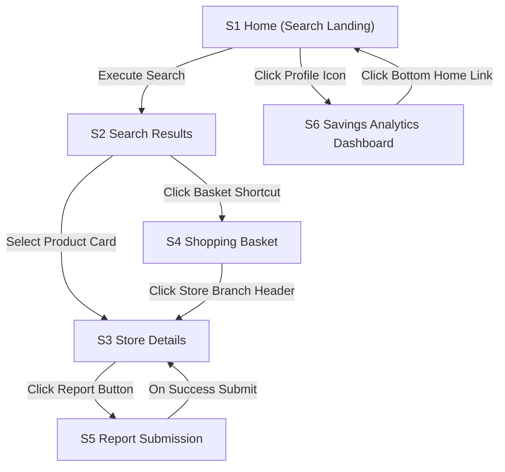

# Product Requirements Document (PRD)

## 1. Project Overview
* **App Name:** Queueless
* **One-Line Description:** A platform that helps users shop smarter by comparing prices across nearby stores, checking product availability, and avoiding unnecessary queues and shopping trips.

## 2. Problem Statement & Goals
* **What problem does this app solve?** Consumers waste time and money visiting physical stores only to find items are out of stock, overpriced, or checkout queues are excessively long. 
* **What are the main objectives of this project?** To provide real-time price comparisons, cross-store basket cost transparency, item availability tracking, and user-reported store queue metrics so shoppers can plan optimal, efficient shopping trips.

## 3. Target Audience
* **Who will use this app?** Budget-conscious shoppers, families managing household grocery expenses, university and college students, young professionals, and everyday consumers looking to reduce travel costs and checkout wait times.

## 4. Key Features (Scope)
* **Feature 1 (User Authentication):** Secure registration and login for Shoppers and participating Retailers.
* **Feature 2 (Location-Based Store Discovery):** Ability to filter and view nearby physical retail outlets within a specified suburb or distance.
* **Feature 3 (Product Search & Comparison):** Search product catalog and view localized alternative store prices ranked from lowest to highest.
* **Feature 4 (Stock Availability Indicators):** Clear display states highlighting item inventory status (`In Stock`, `Limited Stock`, `Out of Stock`, `Unknown`) with price update timestamps.
* **Feature 5 (Shopping Basket Cost Aggregator):** Virtual multi-item basket compilation that aggregates and compares total checkout costs across different store branches to recommend the cheapest destination.
* **Feature 6 (Crowd-Sourced Queue Level Reporter):** Simplified community submission grid allowing users to report physical line wait times at a store branch checkout.
* **Feature 7 (Management Dashboards):** An Administrator view to manage retailers, stores, and products, alongside a Retailer panel for catalog uploads and inventory syncs.

## 5. User Flow & Tech Stack
* **Briefly map out how a user navigates the app:** 
  1. A user lands on the Home Screen and sets their location or suburb filter.
  2. They perform a product search or select an active shopping list basket.
  3. The app presents the ranked price and total cost options across nearby stores, accompanied by queue indicators.
  4. The user selects their destination, visits the store, and optionally logs a quick queue or price report check from the store detail view.
* **Technologies to be used:**
  * **Frontend:** React + Vite (Web view layouts optimized for mobile browser viewports)
  * **Styling:** Tailwind CSS (Modular, light utility framework classes)
  * **Backend & API:** Node.js + Express / Supabase Client Layer
  * **Database:** PostgreSQL (Relational index pairing for products, listings, and user records)
  * **Log-in & Storage:** Supabase Auth and Storage Buckets


| BR2 | Report Throttling Lockout: A user is restricted to a maximum of 5 queue updates and 3 price changes per store branch within any single 60-minute window to avoid data spamming. | F3, S5 |
| BR3 | Basket Consolidation Rule: If a particular store branch does not carry a specific item present within a user’s current multi-item basket, the overall total screen must flag that store with "Missing 1 Item" and calculate aggregate sums based strictly on the available inventory set. | F2, S4 |
| BR4 | Queue Decay Weighting: The displayed live queue level indicator is calculated using a time-weighted average where user reports submitted within the last 15 minutes hold 80% weight, decreasing linearly to 0% weight over 2 hours. | F1, F3, S3 |


### 4.5 Notifications

| Trigger | Who receives it | Channel (in-app / push / email / SMS) | Exact text | Tapping it opens |
| :--- | :--- | :--- | :--- | :--- |
| User crowd-sourced price/queue report is verified | Shopper | In-app notification | "Thank you! Your update for Shoprite Hatfield has been verified. +10 points added." | S6 Savings Analytics Dashboard |
| Total cost of items in saved basket changes by >10% | Shopper | Email | "Price drop alert: Your active grocery basket is now R45 cheaper at Pick n Pay Hatfield!" | S4 Shopping Basket |
| Retailer catalog upload completes successfully | Retailer | Email | "Catalog sync complete: [Number] products updated successfully." | Database dashboard |

---

## 5. Accounts and sign-in

| Decision | Your answer |
| :--- | :--- |
| **Sign-up methods** | Email + password only |
| **Who may sign up** | Anyone (open public registration for shoppers; retailer accounts approved by system admin) |
| **Minimum age** | 16 (Sign Up has the mandatory checkbox "I am 16 or older") |
| **Email or phone verification** | Required via email link. Accounts remain restricted to read-only guest status before verification. |
| **Password rules** | Minimum 8 characters, including at least 1 uppercase letter and 1 number. Show/hide toggle icon included. |
| **Forgot password** | "Forgot password?" link sends a secure reset link via email, valid for exactly 1 hour. |
| **Failed log-in attempts** | Account is temporarily locked for 15 minutes after 5 consecutive incorrect password entries. |
| **Stay logged in** | Session remains active for 30 days before requiring a manual password sign-in re-check. |
| **Log out** | Accessible from S6 Profile menu tray; log out is immediate with a single tap confirmation pop-up. |
| **Delete account** | Triggered in user settings; permanently deletes profile, email logs, and saved baskets within 7 days. |
| **Change email or phone** | Allowed via settings; requires verification code validation sent to the existing verified email address. |

---

## 6. User stories, acceptance criteria and edge cases

### 6.1 Stories

| Story | Feature | User story | Acceptance criteria (with test IDs) |
| :--- | :--- | :--- | :--- |
| **US1** | F1 | As a Shopper, I want to search for a specific grocery product by its name so that I can see which local retail branch has the lowest price. | **T-US1-1**: Given I am on the S1 Search landing page, when I type "White Sugar 2kg" into the lookup bar and tap "Search", then I am redirected to S2 containing a list of matched item results ordered lowest price first.<br><br>**T-US1-2 (unhappy)**: Given the search text yields zero system index matches, when the submission executes, then the view container displays the message "No products found matching your search term. Please try another product name." |
| **US2** | F2 | As a Shopper, I want to add three regular items to a shopping basket so that I can see the aggregate cost comparison across multiple competing stores. | **T-US2-1**: Given I am viewing product results on S2, when I click "Add to Basket" on consecutive rows, then my persistent header badge increments dynamically, and navigating to S4 displays grouped row items with accurate calculated totals.<br><br>**T-US2-2 (unhappy)**: Given my network connection disconnects while appending an item row, when the button is triggered, then an overlay message states "Action failed. Please verify your internet connection and try again." |
| **US3** | F3 | As a logged-in Shopper at a physical store check-out, I want to submit a quick update on current line congestion so that other shoppers can skip long queues. | **T-US3-1**: Given I am on the S3 Store Details page, when I tap the "Report Queue" button, select the "Long Line (30+ Mins Wait)" grid option, and hit "Confirm", then the master record updates and a toast confirmation stating "Queue report submitted. Thank you for your contribution!" displays.<br><br>**T-US3-2 (unhappy)**: Given I attempt to submit a queue report for the exact same store branch 5 minutes after a previous entry, when I click confirm, then the form layout blocks entry with a red label reading "Submission restricted. You can report queue states once every 15 minutes." |

### 6.2 Edge cases

| Situation | What the user sees (exact text) | What the app does |
| :--- | :--- | :--- |
| A store listing is completely missing a price point for an item placed inside a shopper's multi-product composite basket. | `"Price unavailable at this branch"` | App flags the specific branch row panel block with an inventory gap alert and excludes it from absolute lowest aggregate price rankings (BR3). |
| A shopper attempts to issue an inventory report update for a store location situated over 50 kilometers away from their device's approximate coordinates. | `"Location mismatch alert"` | App soft-blocks submission, tagging the entry as unverified within the logging metadata ledger. |
| Database prices update simultaneously while a consumer is actively inspecting an item card display panel. | Live price text shifts color to blue with a brief fade animation effect. | React client state synchronization pulls updated Supabase data streams without demanding manual layout page refreshes. |
| The active user authorization validation token expires completely in the background while a consumer edits a custom basket list title string. | `"Session expired. Please log in again to save your changes."` | Client routes user view state back onto the S2 Login interface block safely preserving non-committed local layout memory changes locally. |

---

## 7. User flows and navigation map

### 7.1 Flows

#### Flow 1: Core Comparative Product Search to Basket Addition (F1, F2)
* **Starts when**: User opens the web app looking to locate cheap sunflower oil.
* **Steps**:
  1. **S1 Home Screen**: User clicks the main keyword entry bar, types "Sunflower Oil 2L", and hits enter.
  2. **S2 Search Results Screen**: System executes database query lookup operations. Displays matched product listing blocks ranked lowest price first.
  3. User clicks on the highest-ranked card item panel row block asset.
  4. **S3 Store Product Comparison Screen**: User inspects specific price differentials across retail networks (e.g., Shoprite vs Pick n Pay).
  5. User taps the primary "Add to Active Basket" action item button element.
* **Ends when**: Header basket count element shifts from 0 to 1, and a bottom toast element shows `"Item added to your basket."`

### 7.2 Navigation map


---

## 8. Screens

### 8.1 Screen inventory
* **S1 Home (Search Landing)**: Entry lookup point with suburb categorization selectors.
* **S2 Search Results**: Matched list grids highlighting price intervals across available item stocks.
* **S3 Store Details**: Individual store branch hubs tracking queue health histories and operating schedules.
* **S4 Shopping Basket**: Combined multi-item aggregator comparing gross basket checkouts side-by-side.
* **S5 Report Submission**: Simplified data input interfaces enabling queue status adjustments.
* **S6 Savings Analytics Dashboard**: Personal performance hubs listing contributor levels and monetary returns.

### 8.2 Screen specification (Sample: S3 Store Details)
* **ID and name**: S3 Store Details
* **Purpose**: Displays individual store branch attributes, pricing inventory, and live queue meters.
* **Who can open it**: Guests and Logged-in Shoppers.
* **Layout (top to bottom)**:
  1. Header with back navigation arrow.
  2. Store name bold string label (e.g., "Shoprite Hatfield").
  3. Queue Metric Panel showing color-coded status badge (e.g., Red "Long Line (30+ Mins Wait)").
  4. Dual action links: "Update Store Price" and "Report Queue Status".
  5. Local item price catalog row cards.

### 8.3 Shared components
* **Global Navigation Header**: Application title text string, context-driven back layout arrows.
* **Offline Banner Component**: High-contrast horizontal alert accent bar reading: `"You're offline. Changes will not be saved."`
* **Status Alert Toast Banner**: Micro information confirmation string panels.

### 8.4 Sample data set
* **Products**: `prod_01` ("Clover Full Cream Milk 2L"), `prod_02` ("Albany Superior White Bread 700g").
* **Stores**: `store_01` ("Shoprite Hatfield"), `store_02` ("Pick n Pay Hatfield").

---

## 9. Design direction

### 9.1 Look and brand
* **Look and feel**: Clean, efficient, high-contrast
* **Primary colour**: Teal Blue `#0B7A6B` (passes contrast 5.1:1 on white fields)
* **Secondary / accent colour**: Mint Green `#2E7D32` (utilized for savings data elements)
* **Background colour**: Pure Clear White `#FFFFFF`
* **Main text colour**: Deep Charcoal `#1A1A1A`
* **Font**: Sans-Serif standard asset token `Inter`
* **Corner radius**: Cards: `8px`; Form input fields: `6px`; Buttons: `24px` capsule format.

### 9.2 Tone of voice
* Direct, supportive, and numeric-centric.
* *Example*: `"Great choice! You are saving R24.50 on this basket selection by choosing Shoprite today."`

### 9.3 Platform rules
* Responsive web grid scaling smoothly up to a maximum constrained view threshold of `1200px` for desktop browser viewports. 
* Mobile layouts (under 640px wide) collapse items into clean single-column linear tracking stacks.

### 9.4 Accessibility
* All primary body copy strings lock onto a minimum dimensions scale of `16px`.


## 10. Data model

### 10.1 Entities and fields

#### Entity: User
*One record represents a single shopper or retailer account registered on the platform.*

| Field | Type | Required? | Default | Unique? | Rules | If the linked record is deleted |
| :--- | :--- | :--- | :--- | :--- | :--- | :--- |
| id | ID | Yes | Auto | Yes | Primary key UUID. | — |
| email | Email | Yes | None | Yes | Must be unique and lowercase. | — |
| password_hash | Text (255) | Yes | None | No | Encrypted character security sequence string. | — |
| role | Choice | Yes | "Shopper" | No | Allowed values: `Shopper`, `Retailer`. | — |
| reward_points | Whole number | Yes | 0 | No | Must be greater than or equal to 0. | — |
| created_at | Date-time | Yes | Now | No | Saved in UTC. | — |

#### Entity: Product
*One record represents a unique retail product configuration cataloged globally within the app.*

| Field | Type | Required? | Default | Unique? | Rules | If the linked record is deleted |
| :--- | :--- | :--- | :--- | :--- | :--- | :--- |
| id | ID | Yes | Auto | Yes | Primary key UUID. | — |
| barcode | Text (30) | Yes | None | Yes | Standard international commercial retail barcode string. | — |
| product_name | Text (150) | Yes | None | No | Descriptive naming string. | — |
| brand_label | Text (80) | Yes | None | No | Manufacturer name. | — |
| volumetric_size | Text (30) | Yes | None | No | Measurement profile (e.g. "2L", "700g"). | — |

#### Entity: Listing
*One record tracks a specific product's price and stock condition mapping at an individual store outlet.*

| Field | Type | Required? | Default | Unique? | Rules | If the linked record is deleted |
| :--- | :--- | :--- | :--- | :--- | :--- | :--- |
| id | ID | Yes | Auto | Yes | Primary key UUID. | — |
| product_id | Link to Product | Yes | None | No | Maps to the global product item definition. | Delete this too |
| store_branch_name | Text (120) | Yes | None | No | Store branch name context (e.g. "Shoprite Hatfield"). | — |
| price_zar | Money (ZAR) | Yes | None | No | Scalar numeric pricing decimal tracking local cost. | — |
| stock_status | Choice | Yes | "In Stock" | No | Allowed values: `In Stock`, `Limited Stock`, `Out of Stock`, `Unknown`. | — |
| verified_at | Date-time | Yes | Now | No | Traces timestamp check bounds to verify data age metrics. | — |

#### Entity: ReportLog
*One record logs an instance where an authenticated user submits a real-time price, stock, or queue update.*

| Field | Type | Required? | Default | Unique? | Rules | If the linked record is deleted |
| :--- | :--- | :--- | :--- | :--- | :--- | :--- |
| id | ID | Yes | Auto | Yes | Primary key UUID. | — |
| user_id | Link to User | Yes | None | No | Tracks the individual shopper making the entry update. | Clear the field |
| listing_id | Link to Listing | Yes | None | No | Connects directly to the targeted outlet product listing. | Delete this too |
| report_type | Choice | Yes | "Queue" | No | Allowed values: `Queue`, `Price`, `Stock`. | — |
| submitted_value | Text (50) | Yes | None | No | Text configuration parameters (e.g. "Long Line", "34.99"). | — |
| created_at | Date-time | Yes | Now | No | Time log execution check parameter. | — |

### 10.2 Relationships
* One Product has many Listings across multiple different physical store branch contexts.
* One User submits many structural entry records into the ReportLog table.
* One Listing row coordinates many real-time community report checks inside the ReportLog table.

### 10.3 Status values and changes

| Entity.field | From | To | Who or what causes it |
| :--- | :--- | :--- | :--- |
| `Listing.stock_status` | `In Stock` | `Out of Stock` | Dispatched via crowd-sourced Shopper update entries or merchant bulk system file syncs. |
| `Listing.stock_status` | `Out of Stock` | `In Stock` | Overwritten via verified user report inputs or direct backend retailer portal inventory changes. |

### 10.4 Reference and seed data
* **Reference Data**: Global suburb catalogs mapping localized South African municipal nodes (e.g. "Hatfield", "Arcadia", "Benoni") must exist before student registration tasks open. Managed cleanly by structural administrators natively inside production storage layers.
* **Seed Testing Profiles**: 
  * Shopper Account: `tester.joy@queueless.co.za` $\rightarrow$ Password string: `JoyPass2026!`.
  * Developer Backend Account: `mpho.dev@queueless.co.za` $\rightarrow$ Password string: `MphoLeadBackend2026#`.

---

## 11. Tech stack and architecture

### 11.1 Stack

| Layer | Your choice (with version) | Why |
| :--- | :--- | :--- |
| **Frontend** | React (v19.0) managed via Vite builder configurations | Delivers rapid single-page application view transitions, well-suited for responsive mobile layouts. |
| **Styling** | Tailwind CSS (v4.0) utility grids | Optimizes performance loops using modular class properties, cutting stylesheet bundle size footprints. |
| **Backend / API Engine** | Supabase JS client integration layer | Connects interface pages straight to persistence matrices without complex custom structural middleware layers. |
| **Database Instance** | PostgreSQL (v16) clustered tables | Guarantees absolute transactional integrity across product lookup index trees and relational user baskets. |
| **Log-in Engine** | Supabase Auth internal JSON Web Tokens | Implements immediate session protection mechanisms using standard encoded encryption validations. |
| **File Storage** | Supabase Storage Bucket framework models | Handles image storage tracking constraints across user catalog image assets smoothly. |
| **Scheduled Sync Jobs** | Supabase Edge Functions coupled with pg_cron extensions | Automates periodic background worker sync operations to drop expired queue metrics linearly under BR4 criteria. |
| **Hosting Platform** | Vercel Deployment Optimization architecture | Delivers minimized edge connection speeds within South Africa utilizing optimized local server caching layers. |
| **Package Manager** | Node Package Manager execution framework `npm` (v10.2) | Standardizes frontend dependency installation loops through strict semantic resolution auditing tracking parameters. |
| **Testing Suite** | Jest Unit Testing configuration packages (v29.7) | Facilitates isolated check routines confirming mathematical computation steps like threshold rate calculations. |
| **Version Control** | Git codebase tracking deployed over public GitHub networks | Anchors collaborative development branches, organizing build tasks through predictable deploy steps. |

### 11.2 Third-party services
* **Resend Email API**: Distributes transactional sign-up account activation tokens directly into user email targets. Accommodates up to 3,000 communications monthly on standard complimentary configurations.

### 11.3 How the parts connect
The shopper opens the application inside a standard mobile web browser. The single-page application interacts with Supabase backend nodes via secure asynchronous API HTTPS channels. Database reads access optimized views that evaluate decay computations (BR4 weight tracking) directly in the PostgreSQL layer, minimizing transaction loads on client web views. User state modification requests invoke strict Row-Level Security checks at the persistence firewall boundary before writing logs.

### 11.4 Permissions (RLS)

| Entity | Action (read / create / update / delete) | Who is allowed | Extra rule |
| :--- | :--- | :--- | :--- |
| **User** | Read / Update | Account Owner Only | Table mappings limit retrieval parameters exactly matching user authorization tokens. |
| **Product** | Read | Open Public Access (Guests & Shoppers) | Master definitions remain searchable globally across all layout views. |
| **Listing** | Read | Open Public Access (Guests & Shoppers) | Pulls active price matrices within selected localized suburb sectors. |
| **Listing** | Update | Verified Shoppers & Retailers | Data inputs undergo checking limits evaluating rate throttling indicators (BR2). |
| **ReportLog** | Create | Authenticated Shoppers | Processing scripts check timestamp intervals to enforce lockout parameters (BR2). |

### 11.5 Environment variables and secrets

| Name | What it is | Where to get it | Public or secret? |
| :--- | :--- | :--- | :--- |
| `VITE_SUPABASE_URL` | Cloud routing link target routing data straight to backend services. | Located inside central management system developer configuration dashboards. | Public. Safely embedded inside client-side production compilation outputs. |
| `VITE_SUPABASE_ANON_KEY` | Public authorization credential key tracking simple base schema lookups. | Located inside central management system developer configuration dashboards. | Public. Secure because granular read/write validations map directly to target RLS settings. |
| `RESEND_API_SECRET_KEY` | Secret programmatic authorization token driving automated email dispatches. | Distributed exclusively via service provider user profile administration panels. | Secret. Contained strictly inside safe server container tasks; blocked from hitting open git history repositories. |

### 11.6 Folder structure
```text
queueless-app/
├── src/
│   ├── components/      # Reusable UI parts (GlobalHeader, ProductCard, OfflineBanner).
│   ├── pages/           # Functional routing screens (Home, Results, Details, Basket).
│   ├── utils/           # Computes math functions handling time-weighted queue decays (BR4).
│   └── supabase/        # Persistent data schema migrations and structural RLS scripts.
├── public/              # Global framework entry optimization configs and site metadata items.
├── docs/                # System documentation specs.
│   └── PRD.md
├── MASTER.md            # Actionable instructions list detailing step-by-step build pathways.
└── package.json         # Master package module mapping registers.
```

### 11.7 Testing plan


## Manual Operational Checklists: Acceptance test markers (e.g. T-US1-1, T-US3-1) execute via standard step-by-step client interface walk-throughs across physical targets during verification checks.

## Automated Unit Suites: Jest routines run computational checks directly across text parsing, constraint rate limit blocks, and decay functions to assert data model stability under high-load variations.


## 12. Quality, errors, security and privacy

### 12.1 Quality requirements

| Area | Requirement (must be checkable) |
| :--- | :--- |
| **Speed** | Every screen shows content or a loading placeholder within 2 seconds on mobile data, tested via browser Performance APIs. |
| **Data usage** | No auto-playing video animations; product card thumbnail image assets compressed under 50 KB; product lists load 10 items at a time. |
| **Offline** | Users can view cached product prices and the shopping basket offline; all save actions are disabled and the offline banner is shown. |
| **Devices** | Works responsively on modern browsers (Chrome, Safari, Edge) from a minimum mobile screen width of 360px up to desktop viewports. |
| **Language and region** | English (South Africa); dates formatted as 12 Mar 2026; 24-hour time notation; SAST zone; currency formatted as R1,234.50; phone numbers in +27 format. |
| **Accessibility** | Interactive touch targets (buttons, links, select components) are at least 44 × 44px; text color pairs maintain a 4.5:1 contrast ratio. |
| **Scale** | Application performance metrics remain stable for up to 500 concurrent users during launch semester windows. |
| **Abuse limits** | Enforces maximum limits of 5 queue updates and 3 price changes per store branch per hour via database tracking (BR2). |

### 12.2 Error messages used everywhere

| Situation | Exact message | What happens next |
| :--- | :--- | :--- |
| **No internet** | `"You're offline. Changes will not be saved."` | High-contrast gray notification ribbon injects below header; save button actions are immediately disabled. |
| **Server or unknown error** | `"Something went wrong. Try again."` | Dispatches retry button prompt below error container; keeps scratchpad state intact. |
| **Logged out because session expired** | `"Session expired. Please log in again to save your changes."` | Redirects client route immediately back onto S2 login page container. |
| **Not allowed (wrong role)** | `"You can't do that."` | Aborts database write execution block cleanly; discards non-authorized state payloads. |
| **Form field error** | `Red border + warning label text underneath the field container` | The specific input field retains the user's typed string parameters for easy user modification. |

### 12.3 Security
* Passwords are handled exclusively via secure cryptographic pipelines within Supabase Auth, never processed or stored as raw strings inside custom application repository code.
* Secret authorization infrastructure strings and API service keys remain sandboxed inside a `.env` configuration file that is strictly blocked from version control tracking history paths.
* Access controls governing data structural mutation writes are managed on the database layer through strict Row-Level Security (RLS) rules assessing authentication token scopes before processing transactions.

### 12.4 Privacy and POPIA
Queueless processes and stores user data tokens in accordance with South Africa's **Protection of Personal Information Act (POPIA)** specifications.

| Personal information | Why you need it | Who can see it | Where it is stored (service and country) | How long you keep it | How the user deletes it |
| :--- | :--- | :--- | :--- | :--- | :--- |
| **Email Address** | To handle unique profile authentication mappings and distribute validation credentials. | Account Holder and System Admins only. | Supabase Cluster (South Africa data center region). | Maintained continuously throughout active profile lifecycle paths. | Handled via account profile cancellation dashboards inside S6 Settings. |
| **User Suburb Preference** | To optimize hyper-local home page content display parameters. | Account Holder and System Admins only. | Supabase Cluster (South Africa data center region). | Maintained continuously throughout active profile lifecycle paths. | Can be updated or cleared inside the S1 profile selection panel tray. |

* **Consent Entry Mechanism**: Registration workflows embed a mandatory confirmation checkbox element (empty by default) next to explicit instructions stating: `"I agree to the Privacy Notice"`, containing a direct hyperlink to the notice document.
* **Privacy Notice Visibility**: Accessible consistently through global application settings and platform footer frames, outlining explicit storage parameters, system purposes, and user right-to-deletion procedures.
* **Under-18 Users Limit**: Compliance checking routines set the absolute minimum registration target baseline parameter to 16 years old, logging explicit user self-certification confirmation vectors during onboarding steps.

---

## 13. Assumptions, risks, open questions and milestones

### 13.1 Assumptions
* **Assumption**: Supermarket branch managers maintain steady intra-day retail price patterns across suburban regions without unannounced, sudden shifts. *Verification step*: Monitored via regular baseline script validation passes checking consistency coefficients across sample locations weekly.
* **Assumption**: Everyday shoppers are willing to log checkout line metrics in public spaces without demanding immediate financial or point-based compensation. *Verification step*: Measured by tracking community submission conversion curves during early developer trial runs.

### 13.2 Risks

| Risk | Likelihood (Low / Medium / High) | Impact (Low / Medium / High) | What you will do about it |
| :--- | :--- | :--- | :--- |
| Fraudulent operators intentionally log inaccurate pricing entries to systematically distort competitor store positions. | Medium | High | Apply frequency write throttling rules (BR2), prioritize highly rated historical profile weights, and introduce peer consensus sweeps. |
| High seasonal transaction loads drag database performance metrics down below speed limits during peak hours. | Medium | Medium | Optimize indexing strategies across product lookup columns and cache stable catalog feeds inside edge layers. |
| Mobile device batteries experience high drain metrics when parsing real-time geolocation routines on low-tier screens. | Low | Medium | Exclude power-hungry live mapping canvas features from MVP scope entirely, utilizing lightweight textual suburb filters instead. |

### 13.3 Open questions
* [x] **Question**: Should product stock conditions map into exact inventory counts or binary presence indicators? *Resolution path*: Implemented four crisp status choice variables (`"In Stock"`, `"Limited Stock"`, `"Out of Stock"`, `"Unknown"`) directly inside index tracking columns to ensure fast crowd-sourced entry workflows for contributors.

### 13.4 Milestones

| Milestone | What is finished | Where to find it (link) | Target date |
| :--- | :--- | :--- | :--- |
| **M0: Idea submitted** | Core conceptual proposal and differentiator brief committed to repository records. | `docs/idea.md` | Done (30 Oct 2026) |
| **M1: PRD approved** | Technical requirement documentation blueprint verified and signed off by facilitator team. | `docs/PRD.md` | 13 Nov 2026 |
| **M2: Design ready** | Responsive layout wireframes and typography style tokens finalized across device formats. | Design file link target | 27 Nov 2026 |
| **M3: MASTER.md ready**| Structural step-by-step deployment instructions checklist verified against development scope definitions. | `MASTER.md` | 04 Dec 2026 |
| **M4: MVP built** | Core multi-store aggregation search algorithms and basket cost evaluators fully operational on test networks. | Production platform link | 08 Jan 2027 |
| **M5: Tested and demoed**| Quality tracking matrices pass manual inspection checklist steps, concluding final deliverable audits. | Testing checklist link | 22 Jan 2027 |

---

## 14. Using your PRD with AI

### Step 0: Style guide first (in your AI design tool)
*Paste Section 9 and Section 8.3, then run this prompt:*
```text
You are a senior UI designer. Using ONLY the design values and shared components I pasted, create a one-page style guide for my app "Queueless": colour swatches with hex codes, the text sizes, spacing, buttons (primary, secondary, danger, disabled), text fields (normal, focused, error), cards, header, tab bar or menu, toast, offline banner and empty-state block. Do not design any app screens yet. Do not add colours, fonts or components I did not list.
```

### Step 1: Generate screens, one at a time
*Paste Sections 2.1, 8.1, 8.4, 9, and the specific 8.2 spec for the target screen, then run this prompt:*
```text
You are a senior UI/UX designer. Design screen "[S# Screen name]" for my web app at 360 px responsive mobile width and 1200 px desktop layout wide frames.
- Reuse the style guide and shared components exactly. Keep the header and tab bar identical to my other screens.
- Include every element in the order listed in the spec. Use the exact labels, placeholder text and messages in quotation marks.
- Fill the screen with the sample content given. Use South African names, places, rand and dates. Never use lorem ipsum.
- Design the Normal state first, then one extra frame for each other state in the spec (Empty, Loading, Error, Offline, Success).
- Do not invent features, buttons, screens or text. If something you need is missing, put a grey box labelled "TODO: [what is missing]" and list all TODOs under the design.
```

### Step 2: Generate MASTER.md (in a chat AI that accepts files, e.g. Claude)
*Attach your whole PRD and links to your final screens, then run this prompt:*
```text
You are a senior software engineer. Using the attached PRD, write MASTER.md: the build plan an AI coding assistant will follow to build this app from an empty folder. Use the PRD's IDs (F#, BR#, US#, S#, M#, T-…) everywhere. Include, in this order:
1. Summary and scope: product, users, Must and Should features, non-goals, and a "Deferred" list of future features that must NOT be built.


2. Tech stack with versions, folder structure, and exact setup and install commands.
3. .env.example with every variable from Section 11.5, marked public or secret.
4. Database: every entity, field, type, default, uniqueness rule, delete behaviour, relationship and status change from Section 10, written as migration steps.
5. Permissions: one rule per row of Section 11.4, enforced in the database or server.
6. Business rules: every BR# with step-by-step logic (pseudocode), and where it runs.
7. Accounts: every decision in Section 5.
8. Navigation: every screen and route from Sections 7.2 and 8.1, and which ones show the tab bar.
9. Design tokens: every value in Section 9 as named tokens; shared components from 8.3.
10. Notifications (4.5), error messages (12.2), and quality, security and privacy rules (12).
11. Seed data and test accounts from Section 10.4.
12. Build phases:
• Phase 1 is always: setup, folder structure, tokens, .env.example, database and seed data, and one screen that runs.
• Each later phase covers 1 or 2 features, all Must before any Should, and ends with an app that runs.
• Each phase lists its F#, US#, S# and BR#, the files to create, and a Definition of Done made of the T- criteria it covers, as checkboxes.
13. Testing checklist: every T- criterion as a checkbox, marked manual or automated.
Rules: do not add anything that is not in the PRD. If the PRD is unclear or contradicts itself, list it under "Clarifications needed" at the top and STOP: do not write the build phases until I answer. State at the top: "Built from PRD version [vX.X]".
```

## 3. Goals, success metrics and non-goals

### 3.1 Goals
Each goal maps to a quantitative target value that can be validated via system event logging counters or controlled group testing sweeps.

| # | Goal | Metric (what you count) | Target | How you will check it |
| :--- | :--- | :--- | :--- | :--- |
| **G1** | Accelerate user product lookup performance | Time elapsed from hitting the submission trigger to rendering matched results inline. | Under 2.0 seconds | Automated client-side telemetry using standard browser performance monitoring hooks. |
| **G2** | Maximize user community engagement indices | Percentage of active registered shoppers who submit at least 2 crowd-sourced reports monthly. | 40% of unique profiles | Database metrics aggregated from the `ReportLog` transaction tables. |
| **G3** | Deliver clear, measurable consumer savings | Aggregated price margin gap between targeted cheapest store basket vs worst-case retail alternatives. | Average R150 saved monthly per shopper | Automated script comparison matching checked basket histories against baseline matrix highs. |

### 3.2 Non-goals
* **No dynamic routing or map visuals**: To minimize cellular data package overheads on low-tier smartphones, the app handles location sorting via simple suburban pick-lists and static distance text blocks rather than heavy embedded map APIs.
* **No internal payment settlement structures**: Queueless does not process commercial transaction checkouts or coordinate fulfillment logistics; it acts completely as a physical pre-trip planning utility guide.
* **No automatic receipt optical recognition**: Community price contributions run on simple numerical input keypads instead of machine-learning image processing routines.

---

## 4. Features, business rules and notifications

### 4.1 Feature list

| ID | Feature name | What the user can do (list every action) | Priority | Goal (G#) | Stories (US#) | Screens (S#) |
| :--- | :--- | :--- | :--- | :--- | :--- | :--- |
| **F1** | Product Search & Price Compare | Look up items via name keywords; browse matching catalog items; check real-time price variances ranked lowest-first. | Must | G1 | US1 | S1, S2, S3 |
| **F2** | Cross-Store Basket Aggregator | Build a virtual product checklist; analyze aggregated gross total costs side-by-side across nearby competing branches. | Must | G3 | US2 | S2, S4 |
| **F3** | Crowd-sourced Queue Level Reporter | Tap a physical branch storefront profile; choose a checkout congestion level bucket; instantly transmit update entries. | Must | G2 | US3 | S3, S5 |
| **F4** | Suburb Filter Settings | Choose a specific local shopping suburb to ground product price fields within a relevant geographic area. | Should | G1 | US4 | S1, S2 |
| **F5** | Savings Log Dashboard | Inspect rolling monthly financial performance summaries and track accumulated points tallies on a personalized profile grid. | Should | G3 | US5 | S6 |

### 4.2 MVP definition
A responsive web application enabling consumers to search for a product catalog item, compare local prices across at least 3 nearby physical stores, compile items inside an aggregate basket list to locate the lowest-cost gross checkout destination, and submit a 1-tap update on live line wait time intervals.

### 4.3 Future features
* Built-in client-side barcode scanning utility utilizing native smartphone camera feeds.
* Conversational interactive WhatsApp integration bot for immediate remote pricing inquiries.
* Watchlist trigger alerts dispatching push updates when monitored staple items experience a localized drop of more than 15%.

### 4.4 Business rules

| ID | Rule (exact logic, numbers and limits) | Used by (F#, S#) |
| :--- | :--- | :--- |
| **BR1** | **Price Age Warning Flag**: Any indexed product price mapping that has not received a verified refresh statement for over 48 hours must inject an amber caution exclamation badge reading: `"Unverified for 2 days"`. | F1, S2, S3 |
| **BR2** | **Reporter Throttling Caps**: To block data spam loops, a single shopper profile is limited to a maximum threshold of 5 checkout queue entries and 3 item price updates per physical store location inside a rolling 60-minute window. | F3, S5 |
| **BR3** | **Incomplete Basket Penalty Mitigation**: If a competitive retail outlet does not stock a specific item included in a user's multi-product composite basket, the aggregator component must flag that row panel with `"Missing 1 Item"`, computing sums strictly across its available intersection set. | F2, S4 |
| **BR4** | **Queue Metric Time Decay Weighting**: The public store checkout queue marker status calculates automatically via a time-weighted database formula where shopper updates submitted within the last 15 minutes hold an 80% weight coefficient, decaying down linearly to 0% weight weight over a 2-hour window. | F1, F3, S3 |

---

## 15. Submission checklist

### Complete
* [x] **No [brackets] or text hints remain**: All temporary placeholders and system guidance tags are scrubbed out, substituted fully with explicit business determinations customized for the Queueless product infrastructure.
* [x] **Every Required segment is completed**: Structural modules match up cleanly with target database tables, removing all instances of unspoken layout holes.
* [x] **One-line pitch fits strict length limits**: The foundational brand summary explains the target audience value parameters succinctly in fewer than 20 total words.
* [x] **All business guidelines map onto identifiable data system handles**: Core execution thresholds match explicit rules labeled using sequential BR# identifiers.
* [x] **Every requirement pathway traces completely from story to confirmation tests**: Full item connectivity links user objectives straight to test verification checklist checkboxes.

### Consistent (the AI breaks here most often)
* [x] **Item naming profiles remain uniform globally**: Core product definitions, schema types, and pricing indicators retain single, fixed terms throughout code trees and specification text layers.
* [x] **Field references across screen specs register in the global data model**: Every input container, button status label, and option choice aligns with fields listed in Section 10 tables.
* [x] **Boundary values match across all modules**: Numerical rate limits, cooldown timelines, and distance radius configurations reflect the exact same parameters on screens, scripts, and rules.

---

## 16. Glossary

| Term | Plain-English meaning |
| :--- | :--- |
| **Acceptance criteria** | The exact checks that prove a feature works, written as Given / When / Then blocks. |
| **API** | The protocol pipeline enabling applications to request data information updates from backend servers. |
| **Backend** | The part of the app that runs on a server: the database, log-in and rules. Users don't see it. |
| **Business rule** | Any rule, limit or calculation the app follows, e.g. "maximum 10 messages a day". |
| **Contrast ratio** | How much text stands out from its background. 4.5 to 1 or more is readable for most people. |
| **Design tokens** | Named design values used in code, e.g. color-primary = #0B7A6B, so every screen matches. |
| **Edge case** | An unusual situation the app must still handle, e.g. a user deletes their account in the middle of a booking. |
| **Entity** | One kind of thing your app stores, e.g. User or Order. |
| **Environment variable** | A setting or key stored outside your code, in a .env file. |
| **Frontend** | The part of the app users see and touch. |
| **Hex code** | A colour written as # plus 6 characters, e.g. #0B7A6B. |
| **MASTER.md** | The step-by-step build plan, generated from your PRD, that an AI coding assistant follows. |
| **Mermaid** | A simple text language for drawing diagrams that many AI tools and GitHub can display. |
| **Modal** | A pop-up box that appears on top of a screen, e.g. "Are you sure?" |
| **MoSCoW** | A way to prioritise: Must, Should, Could, Won't. |
| **MVP** | Minimum Viable Product: the smallest version of the app that still solves the main problem. |
| **Persona** | An imaginary but realistic person who represents a type of user. |
| **POPIA** | The Protection of Personal Information Act, South Africa's privacy law. |
| **Row-Level Security (RLS)** | A database rule that controls which rows each user may read or change, e.g. only their own. |
| **Seed data** | Fake data loaded into the database for testing and demos. |
| **SAST** | South African Standard Time (UTC+2). |
| **Stack** | The set of tools and technologies used to build the app. |
| **State (of a screen)** | How a screen looks in a situation: normal, empty, loading, error, offline or success. |
| **Toast** | A short message that appears briefly and disappears by itself. |
| **Unhappy path** | What happens when something goes wrong: wrong input, no internet, no results, or not allowed. |
| **User story** | A feature described from the user's point of view: As a…, I want to…, so that…. |
| **UTC** | The world standard time zone. Store times in UTC; show them in SAST. |
