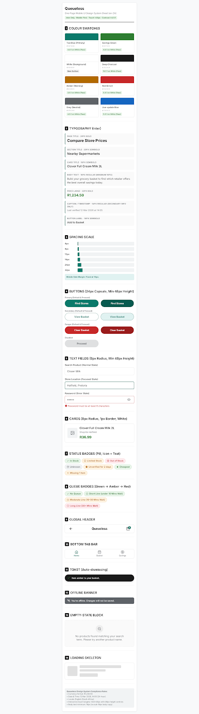
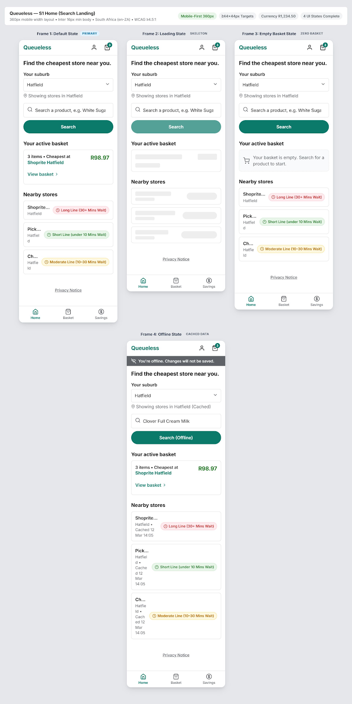
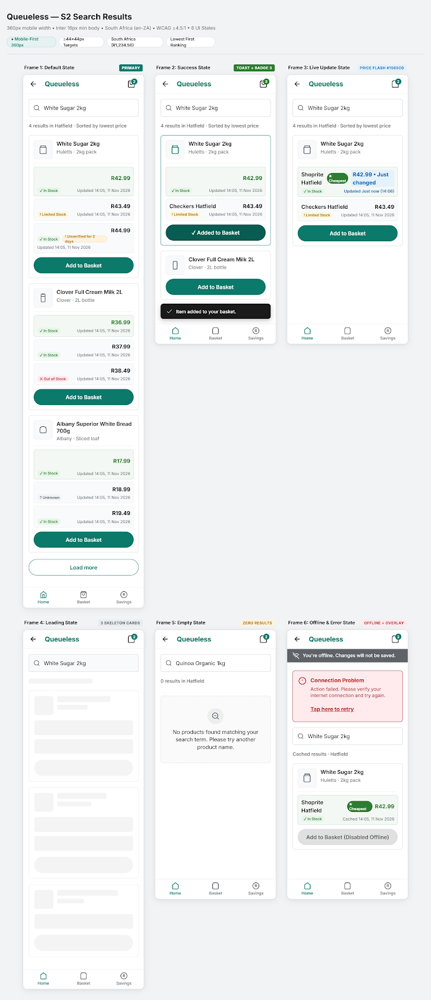
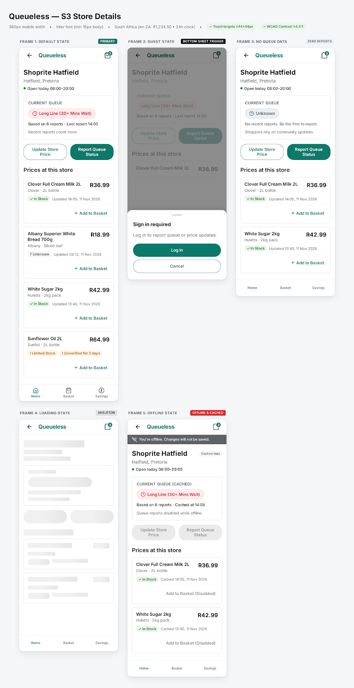
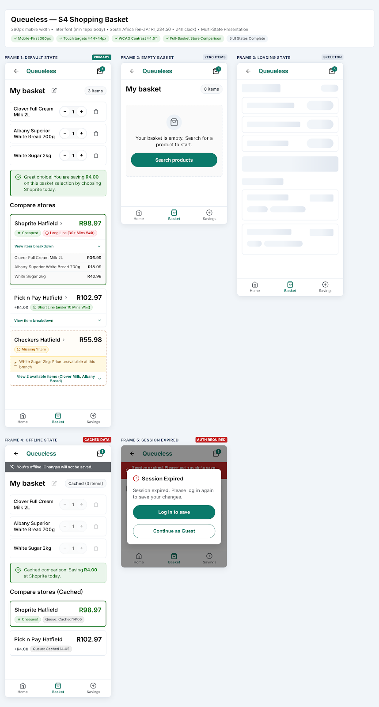
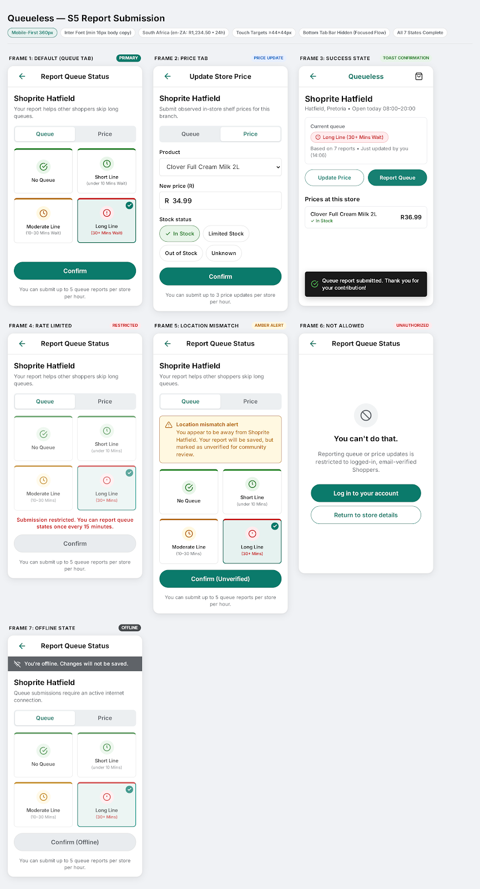
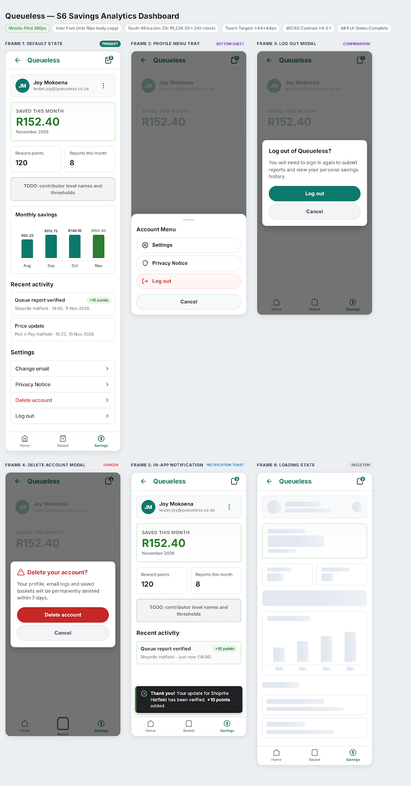
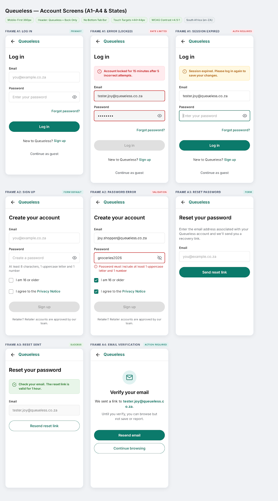

# Queueless designs

Screen designs exported from [Stitch](https://stitch.withgoogle.com/projects/14854798444949179025). The Stitch project is the editable source; these images are the snapshot the build follows (see [Implementation plan §9.2](../Implementation%20plan.md)).

Each screen has three images: **mobile** (360px), **states** (loading, empty, error, offline, success…) and **desktop** (1200px). The matching Stitch HTML is in [`html/`](html/) for reference only. Don't copy it into the app.

| Screen | Mobile | States | Desktop |
|---|---|---|---|
| Design system | [00-design-system.png](00-design-system.png) | — | — |
| S1 Home (Search Landing) | [mobile](s1-home-mobile.png) | [states](s1-home-states.png) | [desktop](s1-home-desktop.png) |
| S2 Search Results | [mobile](s2-search-results-mobile.png) | [states](s2-search-results-states.png) | [desktop](s2-search-results-desktop.png) |
| S3 Store Details | [mobile](s3-store-details-mobile.png) | [states](s3-store-details-states.png) | [desktop](s3-store-details-desktop.png) |
| S4 Shopping Basket | [mobile](s4-shopping-basket-mobile.png) | [states](s4-shopping-basket-states.png) | [desktop](s4-shopping-basket-desktop.png) |
| S5 Report Submission | [mobile](s5-report-submission-mobile.png) | [states](s5-report-submission-states.png) | [desktop](s5-report-submission-desktop.png) |
| S6 Savings Analytics Dashboard | [mobile](s6-savings-dashboard-mobile.png) | [states](s6-savings-dashboard-states.png) | [desktop](s6-savings-dashboard-desktop.png) |
| A1–A4 Account screens | [mobile](a1-a4-account-mobile.png) | [states](a1-a4-account-states.png) | [desktop](a1-a4-account-desktop.png) |

## Design system

## S1 Home (Search Landing)

## S2 Search Results

## S3 Store Details

## S4 Shopping Basket

## S5 Report Submission

## S6 Savings Analytics Dashboard

## A1–A4 Account screens

> When a design changes in Stitch, export it again and replace the image here with the **same file name**, so the links in the implementation plan keep working.
